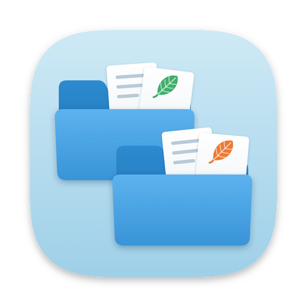
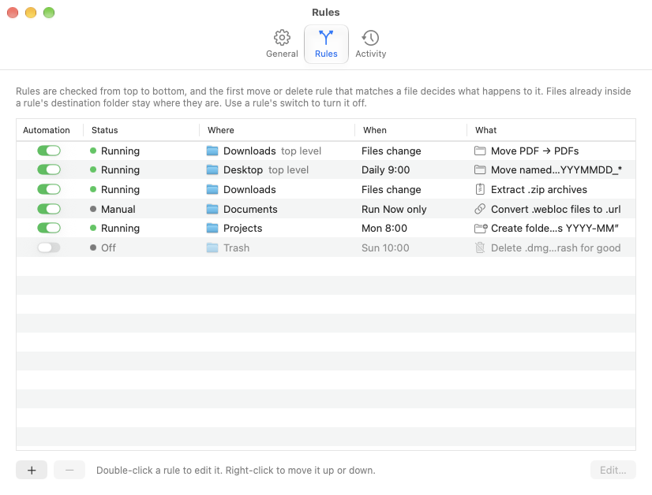

### `Foliarium`

Foliarium tidies your Mac's folders by itself. You write a few rules, like "PDFs in Downloads go to Documents/PDFs", and it files, converts and cleans up as files arrive.

  <a href="https://github.com/semicolonconsulting/foliarium/releases/latest">
    Download
  </a>
  •
  <a href="docs/guide.md">
    Documentation
  </a>
  •
  <a href="https://github.com/semicolonconsulting/foliarium/releases">
    Release Notes
  </a>

 

### What it does

- **Rules for any folder.** Each rule says where to look, when to run (as files arrive, on a schedule, or only when you click Run Now) and what to do: move files, move them to the Trash or change their extension, picking them by kind, extension or name pattern.
- **Converts the awkward files.** Finder aliases become symlinks, `.webloc` bookmarks become Windows `.url` files, `.textClipping` files become `.txt`, and `.zip` archives are extracted.
- **Makes folders and empties the Trash.** A rule can create a folder with a name you choose, dated if you like ("Scans 2026-11"), and another can delete matching items from the Trash for good, optionally only once they've been there for some days.
- **Nothing is lost by accident.** Originals go to the Trash, where Put Back works, and nothing is overwritten. Only a "Delete files in Trash" rule you set up deletes anything for good, and only items already in the Trash. Preview shows what Run Now would do before it does it, and Activity lists everything that was done.

### Install

Download the latest release from [Releases](https://github.com/semicolonconsulting/foliarium/releases/latest), open it and drag Foliarium onto Applications. It needs macOS 14 Sonoma or later. Foliarium lives in the menu bar, and the first time it opens, its Settings window opens so you can add a rule.

### Contributing

Bugs and ideas are welcome in [GitHub Issues](https://github.com/semicolonconsulting/foliarium/issues). To build the app yourself, see [Build from source](docs/building.md).

### License

MIT. See [LICENSE](LICENSE).
